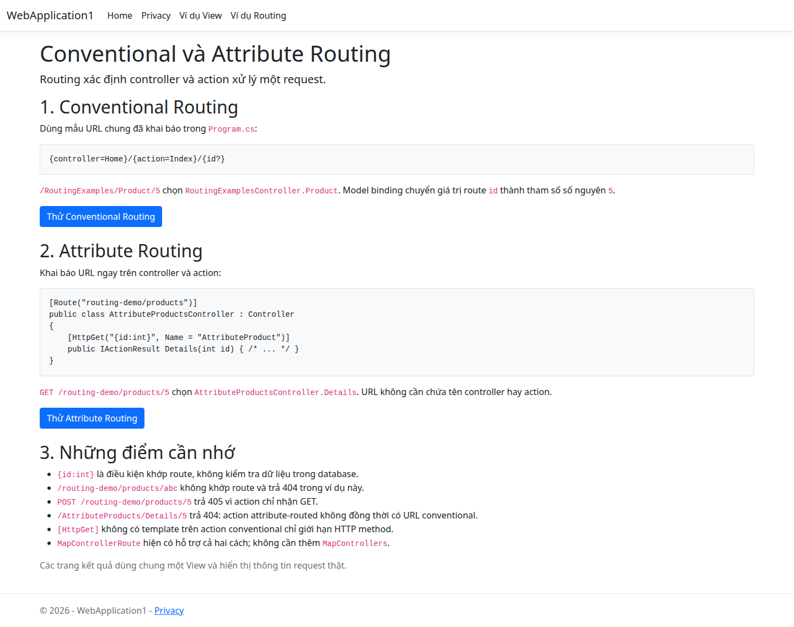
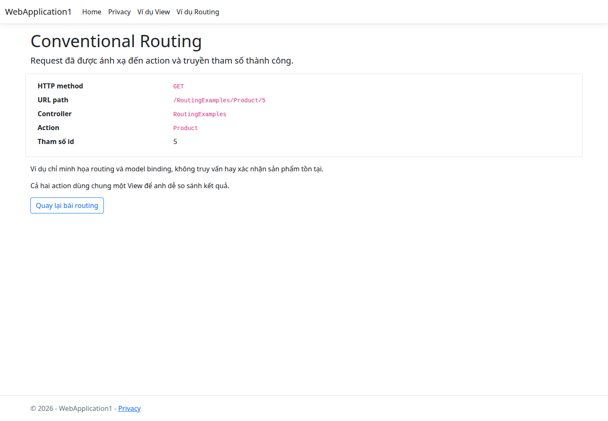
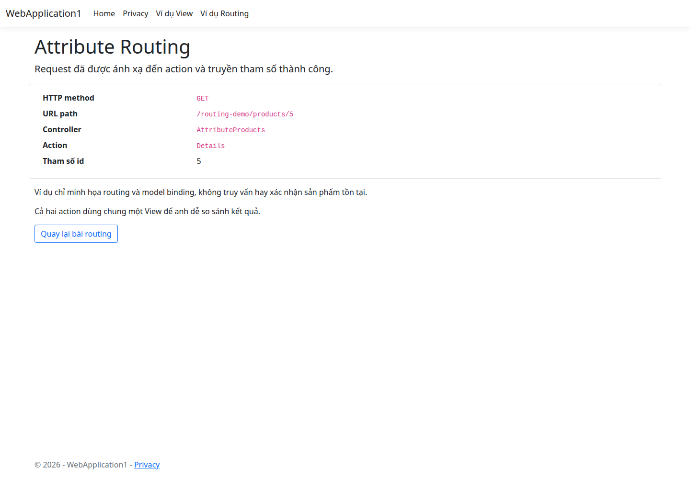

# Conventional Routing và Attribute Routing

Routing xác định endpoint xử lý request. Trong ASP.NET Core MVC, endpoint thường là một action của controller. Sau khi chọn action, model binding chuyển các giá trị trong request thành tham số của action.

## 1. Conventional Routing: dùng quy ước chung

Dự án khai báo trong `WebApplication1/Program.cs`:

```csharp
app.MapControllerRoute(
    name: "default",
    pattern: "{controller=Home}/{action=Index}/{id?}");
```

- `controller=Home`: controller mặc định là Home.
- `action=Index`: action mặc định là Index.
- `id?`: đoạn id không bắt buộc.

| URL | Action được chọn |
|---|---|
| `/` | `HomeController.Index()` |
| `/Home/Privacy` | `HomeController.Privacy()` |
| `/ViewExamples` | `ViewExamplesController.Index()` |
| `/RoutingExamples/Product/5` | `RoutingExamplesController.Product(5)` |
| `/Hello/Welcome/3?name=Anh` | `HelloController.Welcome("Anh", 3)` |

Ví dụ đã triển khai trong `Controllers/RoutingExamplesController.cs`:

```csharp
[HttpGet]
public IActionResult Product(int id)
{
    return View("Result", new RoutingExampleViewModel
    {
        RoutingType = "Conventional Routing",
        ProductId = id
    });
}
```

`[HttpGet]` không có template chỉ giới hạn HTTP method, không chuyển action này sang attribute routing. Nếu bỏ đoạn id trong URL, route vẫn có thể khớp vì `{id?}` là tùy chọn; trong ví dụ này tham số `int id` nhận giá trị mặc định 0. Khai báo `int id` trong C# không tự làm đoạn URL trở thành bắt buộc.

Conventional routing phù hợp với nhiều trang MVC theo mẫu chung. Nếu khai báo nhiều conventional route, đặt route cụ thể trước route tổng quát; thứ tự đăng ký có ý nghĩa khi chọn route.

## 2. Attribute Routing: khai báo ngay tại controller/action

Ví dụ đã triển khai trong `Controllers/AttributeProductsController.cs`:

```csharp
[Route("routing-demo/products")]
public class AttributeProductsController : Controller
{
    [HttpGet("{id:int}", Name = "AttributeProduct")]
    public IActionResult Details(int id)
    {
        return View("~/Views/RoutingExamples/Result.cshtml", new RoutingExampleViewModel
        {
            RoutingType = "Attribute Routing",
            ProductId = id
        });
    }
}
```

Template trên controller ghép với template trên action:

```text
routing-demo/products + {id:int} => /routing-demo/products/5
```

URL không cần chứa tên `AttributeProducts` hoặc `Details`. Attribute routing dùng được cho cả trang HTML và API; ví dụ này trả HTML để quan sát trực tiếp trên trình duyệt.

- `GET /routing-demo/products/5`: vào `Details(5)`.
- `GET /routing-demo/products/abc`: 404 vì `abc` không đáp ứng constraint `int` và không có endpoint khác khớp trong ứng dụng này.
- `POST /routing-demo/products/5`: 405 vì route tồn tại nhưng action không nhận POST.
- `GET /AttributeProducts/Details/5`: 404; action đã dùng attribute routing không tự có thêm đường dẫn conventional.

Template action bắt đầu bằng `/` hoặc `~/` không ghép với tiền tố trên controller. Attribute route thường được chọn theo độ cụ thể của template, không đơn thuần theo thứ tự các phương thức trong file.

### Route constraint không phải validation

`{id:int}` quyết định route có khớp không. Nó không chứng minh sản phẩm tồn tại hoặc id lớn hơn 0. Các quy tắc nghiệp vụ phải được kiểm tra riêng.

Nếu dùng route `{id}` không có constraint, request có thể khớp rồi thất bại ở bước chuyển `abc` sang `int`. Với controller có `[ApiController]`, lỗi model binding này thường tự trả 400. Controller MVC trong ví dụ hiện tại không gắn `[ApiController]`, nên không được suy ra hành vi tự động 400 đó.

## 3. MapControllerRoute và MapControllers

- `MapControllerRoute(...)`: thêm mẫu conventional và ánh xạ cả action attribute-routed.
- `MapControllers()`: ánh xạ action attribute-routed, không tạo mẫu conventional.
- Vì dự án đã gọi `MapControllerRoute(...)`, không cần thêm `MapControllers()` để ví dụ trên hoạt động.
- Một ứng dụng có thể kết hợp cả hai kiểu; một action attribute-routed không đồng thời được truy cập qua conventional route.

## 4. Sinh liên kết bằng routing helper

Trang `Views/RoutingExamples/Index.cshtml` dùng Tag Helpers, thay vì tự ghép URL:

```cshtml
<a asp-controller="RoutingExamples" asp-action="Product" asp-route-id="5">
    Thử Conventional Routing
</a>

<a asp-route="AttributeProduct" asp-route-id="5">
    Thử Attribute Routing
</a>
```

`AttributeProduct` là tên route dùng để tạo URL. Tên route không thay đổi cách khớp request đầu vào. `Url.Action` cũng có thể tạo URL cho cả hai kiểu routing.

## 5. So sánh và liên hệ với View

| Tiêu chí | Conventional | Attribute |
|---|---|---|
| Khai báo | Mẫu chung trong Program.cs | Controller/action |
| Đường dẫn mẫu | `/RoutingExamples/Product/5` | `/routing-demo/products/5` |
| Phù hợp điển hình | Website MVC nhiều trang theo quy ước | API hoặc URL cần kiểm soát rõ |
| Kết quả action | View, JSON, redirect… | View, JSON, redirect… |

```text
Request -> Routing -> Model binding -> Action -> View
                                             -> Partial View / View Component
                                             -> HTML response
```

Routing không phải View Component. View Component không tự có URL; nó được gọi khi tạo giao diện.

## 6. Chạy thử

Khởi động ứng dụng theo [README](../README.md), mở:

1. http://localhost:5048/RoutingExamples
2. Bấm **Thử Conventional Routing**: thấy controller `RoutingExamples`, action `Product`, id `5`.
3. Quay lại rồi bấm **Thử Attribute Routing**: thấy controller `AttributeProducts`, action `Details`, id `5`.

Hai action dùng chung `Views/RoutingExamples/Result.cshtml`. Thông tin HTTP method, URL, controller và action trên trang kết quả lấy từ request thực tế. Không có database hoặc thao tác tạo/sửa sản phẩm.

## 7. Ảnh chụp ứng dụng thực tế

### Trang tổng quan



### Kết quả Conventional Routing



### Kết quả Attribute Routing



## Nguồn tham khảo

[Microsoft Learn — Routing to controller actions in ASP.NET Core](https://learn.microsoft.com/en-us/aspnet/core/mvc/controllers/routing?view=aspnetcore-8.0)
