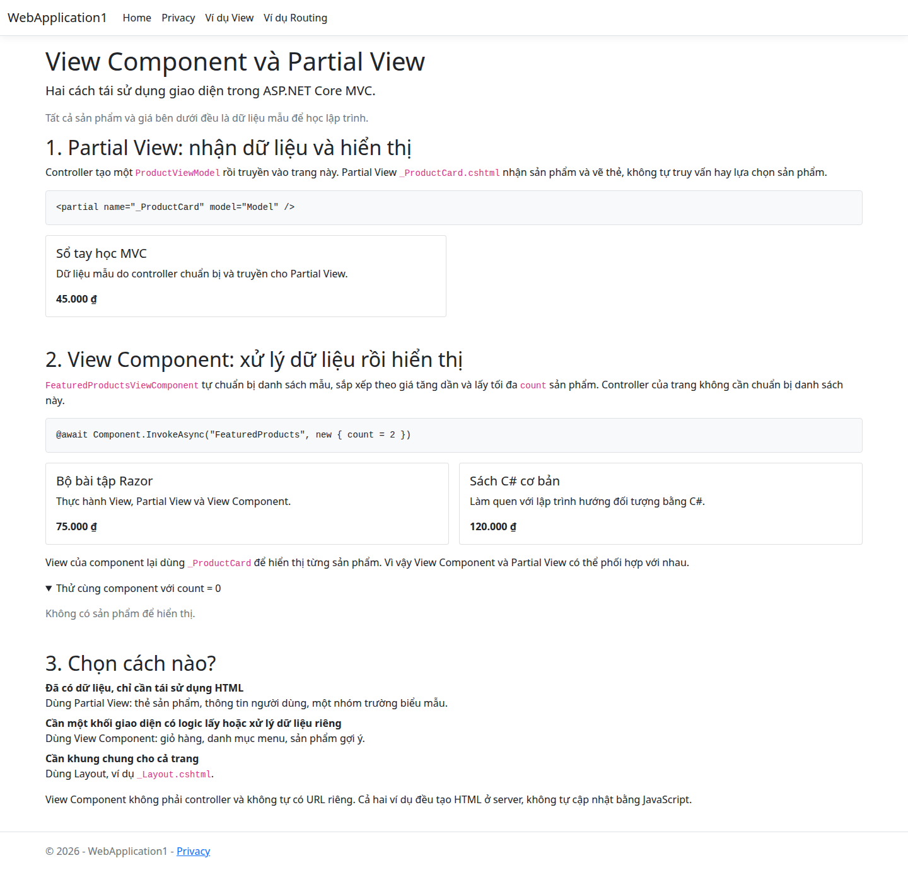

# View Component và Partial View trong ASP.NET Core MVC

Ví dụ dành cho dự án .NET 8 này. Thuật ngữ đang dùng là **Partial View**, không phải “Portal View”. Tất cả sản phẩm và giá là dữ liệu minh họa, không cần database hay package mới.

## Chạy ví dụ

Tại thư mục gốc repo, với .NET SDK 8 đã cài:

```bash
dotnet build WebApplication1/WebApplication1.csproj
dotnet run --project WebApplication1 --launch-profile http
```

Nếu dùng bản SDK cài riêng trên máy hiện tại, đặt biến môi trường trước khi chạy:

```bash
export DOTNET_ROOT="$HOME/.dotnet/sdk-8.0.426-local"
```

Mở http://localhost:5048/ViewExamples hoặc chọn **Ví dụ View** trên thanh điều hướng. Nếu cổng 5048 đang được ứng dụng cũ sử dụng, dừng phiên chạy cũ trước khi khởi động lại. Nhấn Ctrl+C để dừng phiên chạy trong terminal.

## 1. Partial View

Partial View là một file Razor `.cshtml` biểu diễn phần giao diện có thể dùng lại. Nó không chạy `_ViewStart.cshtml`; dấu gạch dưới trong tên file là quy ước, không bắt buộc.

Trong ví dụ này:

1. `Controllers/ViewExamplesController.cs` tạo sản phẩm “Sổ tay học MVC”.
2. Controller truyền `ProductViewModel` vào `Views/ViewExamples/Index.cshtml`.
3. Trang truyền model vào `Views/Shared/_ProductCard.cshtml`:

```cshtml
<partial name="_ProductCard" model="Model" />
```

Partial View nhận đúng kiểu model:

```cshtml
@model ProductViewModel

<h3>@Model.Name</h3>
<p>@Model.Description</p>
```

Nên dùng Partial View khi dữ liệu đã có sẵn và cần tái sử dụng cách hiển thị. Partial vẫn có thể dùng Razor `if`/`foreach` để render; không nên đặt nghiệp vụ hoặc truy vấn dữ liệu phức tạp trong nó. Razor tự encode giá trị như `@Model.Name`, không cần `Html.Raw`.

## 2. View Component

View Component đóng gói logic chuẩn bị dữ liệu cùng giao diện của một khối có thể dùng lại.

Trong `ViewComponents/FeaturedProductsViewComponent.cs`:

- Class kế thừa `ViewComponent` và có phương thức `Invoke(int count)`.
- Tạo danh sách 3 sản phẩm mẫu độc lập với model của trang.
- Sắp xếp theo giá tăng dần, giới hạn số lượng bằng `count`.
- Chặn số âm về 0 và số quá lớn về số sản phẩm hiện có.
- Gọi `View(selectedProducts)` để render view mặc định.

View nằm ở đường dẫn theo quy ước:

```text
Views/Shared/Components/FeaturedProducts/Default.cshtml
```

Gọi từ trang Razor:

```cshtml
@await Component.InvokeAsync("FeaturedProducts", new { count = 2 })
```

`Component.InvokeAsync` là helper gọi component; class component vẫn có thể dùng `Invoke` đồng bộ nếu chỉ xử lý dữ liệu trong bộ nhớ như ví dụ này. Nếu phải gọi database/API bất đồng bộ, dùng `InvokeAsync` trả về `Task<IViewComponentResult>` và inject service qua constructor, thay vì tạo async giả với `Task.Run`.

Component không tự có HTTP endpoint, không dùng model binding để nhận tham số từ URL. Tham số `count` ở đây đến từ lời gọi trong Razor, không phải query string. Nếu cần thay đổi theo request, controller có thể đọc/kiểm tra request rồi view truyền giá trị đó vào component.

## 3. Hai cách phối hợp với nhau

```text
GET /ViewExamples
  -> ViewExamplesController.Index()
  -> Views/ViewExamples/Index.cshtml
       -> _ProductCard(Model): thẻ sản phẩm từ controller
       -> FeaturedProducts(count: 2)
            -> tạo / sắp xếp / giới hạn dữ liệu
            -> Components/FeaturedProducts/Default.cshtml
                 -> _ProductCard(product) cho từng sản phẩm
```

Kết quả mong đợi:

- Phần Partial View: Sổ tay học MVC — 45.000 ₫.
- Phần View Component: Bộ bài tập Razor — 75.000 ₫, rồi Sách C# cơ bản — 120.000 ₫.
- Mở phần `count = 0`: thấy “Không có sản phẩm để hiển thị.”
- Sách ASP.NET Core giá 180.000 ₫ không xuất hiện vì chỉ lấy 2 sản phẩm rẻ nhất.

Sửa giao diện `_ProductCard.cshtml` một lần sẽ áp dụng cho cả thẻ do controller truyền vào và các thẻ trong View Component.

## So sánh nhanh

| Tiêu chí | Partial View | View Component |
|---|---|---|
| Thành phần chính | File `.cshtml` | Class C# và view `.cshtml` |
| Nguồn dữ liệu thường dùng | Được bên gọi truyền vào | Component chuẩn bị hoặc lấy qua service |
| Logic riêng phức tạp | Không nên | Phù hợp |
| Lời gọi trong ví dụ | `<partial name="_ProductCard" model="Model" />` | `@await Component.InvokeAsync("FeaturedProducts", new { count = 2 })` |
| Trường hợp dùng | Thẻ sản phẩm, nhóm trường biểu mẫu | Giỏ hàng, menu động, danh sách gợi ý |

Cả hai tạo HTML phía server, không tự mang lại tương tác phía client như React/Blazor. Khung chung của toàn trang nên dùng Layout.

## Ảnh chụp ứng dụng thực tế

Ảnh sau được chụp tại `/ViewExamples`, với phần `count = 0` được mở để thấy cả trường hợp danh sách rỗng.



## Tài liệu chính thức

- [Partial views — Microsoft Learn](https://learn.microsoft.com/en-us/aspnet/core/mvc/views/partial?view=aspnetcore-8.0)
- [View components — Microsoft Learn](https://learn.microsoft.com/en-us/aspnet/core/mvc/views/view-components?view=aspnetcore-8.0)
